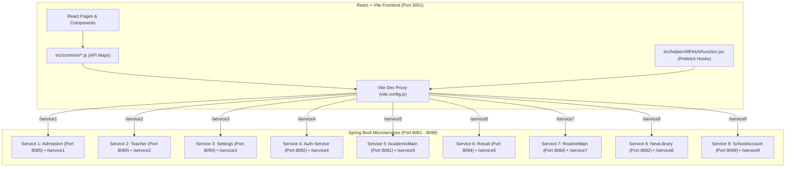

# School SaaS: Frontend & Backend Architecture and Endpoint Reference Guide

This document provides a comprehensive map of the **School SaaS Platform**, documenting the architecture, Vite proxy routing mechanism, and a complete directory-by-directory breakdown of all API endpoints used across the frontend, their corresponding Spring Boot backend microservices, controllers, and exact business operations.

---

## 1. System Architecture & Routing Map

The application consists of a **Vite + React Single-Page Application (Frontend)** communicating with **9 Spring Boot Microservices (Backend)**.



### Vite Dev Server Proxy Configuration (`vite.config.js`)

In local development, the frontend runs on `http://localhost:3001`. In `.env`, `VITE_API_BASE_URL=""` makes API calls relative, which are intercepted by the Vite dev server proxy and routed to the corresponding Spring Boot microservice while rewriting the path prefix:

| Proxy Route | Target Service | Local Port | Microservice Directory | Core Responsibilities |
| :--- | :--- | :--- | :--- | :--- |
| `/service1` | **Admission & School** | `8085` | `Admission-0.0.1-SNAPSHOT` | Student enrollment, admissions, school profile, attendance, signups |
| `/service2` | **Teacher & Staff** | `8089` | `teacher-0.0.1-SNAPSHOT` | Teacher profiles, EDP staff, Librarian accounts, assignments |
| `/service3` | **Global Settings** | `8090` | `Settings-0.0.1-SNAPSHOT` | System lookup data: Blood groups, Genders, Religions |
| `/service4` | **Auth-Service** | `8092` | `auth-service-0.0.2-SNAPSHOT`| User authentication, JWT tokens, Login, Logout, Password reset |
| `/service5` | **AcademicMain** | `8081` | `AcademicMain-0.0.1-SNAPSHOT`| Academic structure: Classes, Sections, Subjects, Classrooms |
| `/service6` | **Result** | `8094` | `Result-0.0.1-SNAPSHOT` | Grading scales, Mark registers, Student exam results |
| `/service7` | **RoutineMain** | `8084` | `RoutineMain-0.0.1-SNAPSHOT`| Class timetables, Exam schedules, Event notifications, Admit cards |
| `/service8` | **NewLibrary** | `8082` | `NewLibrary-0.0.1-SNAPSHOT` | Book categories, Book inventory catalog, Lending & Returning books |
| `/service9` | **SchoolAccount** | `8099` | `SchoolAccount-0.0.2-SNAPSHOT`| Fee structures, Tuition collection, Incomes, Expenses, Bank ledgers |

> **Multi-Tenancy Note**: All tenant operations require `schoolId` (e.g. `/{schoolId}`), which is saved in Redux state (`state.auth.schoolId`) upon login and appended to each request URL.

---

## 2. Frontend Folder-by-Folder Endpoint Catalog

Below is the complete reference of every frontend directory, component, endpoint path, HTTP method, backend controller, and business operation.

---

### Folder: `src/pages/academic` & `src/utils/academic`
* **Primary Backend Service**: `Service 5: AcademicMain` (Port `8081`, Proxy `/service5`)
* **Endpoint Map Config**: `src/common/index.js` (`academicUrlApi`)
* **Redux Slices**: `classSlice.js`, `sectionSlice.js`, `subjectSlice.js`

| Frontend File | HTTP Method | Endpoint Path | Backend Controller | What Work It Does / Purpose |
| :--- | :--- | :--- | :--- | :--- |
| `ClassPage.jsx` | `GET` | `/service5/api/v1/Academic/classes/{schoolId}` | `ClassController.java` | Retrieves all registered classes (e.g., Class 1 - 10, Pre-Primary) for the school. |
| `ClassPage.jsx` | `POST` | `/service5/api/v1/Academic/classes/{schoolId}` | `ClassController.java` | Adds a new class level with name and numeric ordering. |
| `ClassPage.jsx` | `PUT` | `/service5/api/v1/Academic/classes/{id}/{schoolId}` | `ClassController.java` | Updates class metadata or display name. |
| `ClassPage.jsx` | `DELETE` | `/service5/api/v1/Academic/classes/{id}/{schoolId}` | `ClassController.java` | Deletes a class record via `DeleteComponent.jsx`. |
| `SectionPage.jsx` | `GET` | `/service5/api/v1/Academic/sections/all/{schoolId}` | `SectionsController.java` | Lists all universal + school-specific class sections (e.g., Section A–E). |
| `SectionPage.jsx` | `POST` | `/service5/api/v1/Academic/sections/{schoolId}` | `SectionController.java` | Creates a new section for class grouping. |
| `SectionPage.jsx` | `PUT` | `/service5/api/v1/Academic/sections/{id}/{schoolId}` | `SectionController.java` | Renames or updates section details. |
| `SubjectPage.jsx` | `GET` | `/service5/api/v1/Academic/subjects/{schoolId}` | `SubjectController.java` | Lists academic subjects with subject codes (e.g., MATH101, ENG01). |
| `SubjectPage.jsx` | `POST` | `/service5/api/v1/Academic/subjects/{schoolId}` | `SubjectController.java` | Adds a new curriculum subject (theory, practical credits). |
| `SubjectPage.jsx` | `PUT` | `/service5/api/v1/Academic/subjects/{id}/{schoolId}` | `SubjectController.java` | Updates subject details and credit requirements. |
| `SubjectAssignPage.jsx` | `GET` | `/service5/api/v1/Academic/subject-assign/{schoolId}` | `SubjectAssignController.java` | Lists current assignments linking subjects to teachers, classes, and sections. |
| `SubjectAssignPage.jsx` | `POST` | `/service5/api/v1/Academic/subject-assign/{schoolId}` | `SubjectAssignController.java` | Assigns a subject to a specific teacher and class-section pair. |
| `SubjectAssignPage.jsx` | `PUT` | `/service5/api/v1/Academic/subject-assign/{id}/{schoolId}` | `SubjectAssignController.java` | Modifies or re-assigns a subject teacher. |
| `ClassRoomPage.jsx` | `GET` | `/service5/api/v1/Academic/class-room/{schoolId}` | `ClassRoomController.java` | Retrieves all physical classrooms, room numbers, and student seating capacities. |
| `ClassRoomPage.jsx` | `POST` | `/service5/api/v1/Academic/class-room/{schoolId}` | `ClassRoomController.java` | Adds a new physical room record (Room No., Building, Floor, Capacity). |
| `ClassRoomPage.jsx` | `PUT` | `/service5/api/v1/Academic/class-room/{id}/{schoolId}` | `ClassRoomController.java` | Updates room capacity or room numbering. |
| `ClassRoomPage.jsx` | `GET` | `/service5/api/v1/Academic/class-room/{schoolId}/search?classId={id}` | `ClassRoomController.java` | Searches for classroom allocation by assigned class. |

---

### Folder: `src/pages/Accounts`
* **Primary Backend Services**: `Service 9: SchoolAccount` (Port `8099`, Proxy `/service9`) & `Service 1: Admission` (Port `8085`, Proxy `/service1`)
* **Endpoint Map Config**: `src/common/main.js` (`accountApi`, `mainUrlApi`)
* **Redux Slices**: `accountSlice.js`, `feesSlice.js`

| Frontend File | HTTP Method | Endpoint Path | Backend Controller | What Work It Does / Purpose |
| :--- | :--- | :--- | :--- | :--- |
| `BankTransactionPage.jsx` | `GET` | `/service9/bank-transactions/all/{schoolId}` | `BankTransactionController.java` | Retrieves history of bank deposits, withdrawals, and inter-account transfers. |
| `BankTransactionPage.jsx` | `POST` | `/service9/bank-transactions/{schoolId}` | `BankTransactionController.java` | Logs a new bank transaction with voucher number, transaction date, and amount. |
| `ExpensePage.jsx` | `GET` | `/service9/expenses/all/{schoolId}` | `ExpenseController.java` | Lists all operational school expenses (utilities, salaries, repairs, purchases). |
| `ExpensePage.jsx` | `POST` | `/service9/expenses/{schoolId}` | `ExpenseController.java` | Logs a new school expense with expense category, payment mode, and receipt. |
| `IncomePage.jsx` | `GET` | `/service9/income/all/{schoolId}` | `IncomePageController.java` | Lists all miscellaneous non-tuition revenues (facility rentals, donations, events). |
| `IncomePage.jsx` | `POST` | `/service9/income/{schoolId}` | `IncomePageController.java` | Records a new miscellaneous income voucher. |
| `ReportsPage.jsx` | `POST` | `/service9/account/create/{schoolId}` | `AccountDetailsController.java` | Creates / initializes the master financial account ledger for the school. |
| `ReportsPage.jsx` | `GET` | `/service9/account/get/{schoolId}` | `AccountDetailsController.java` | Fetches the school's general balance, total income, and total expenses. |
| `ReportsPage.jsx` | `GET` | `/service9/income/cash-in-hand/{schoolId}` | `IncomePageController.java` | Calculates total physical cash collected and unbanked balance. |
| `ReportsPage.jsx` | `GET` | `/service9/income/online-payments/{schoolId}` | `IncomePageController.java` | Calculates total revenue processed via online digital payment gateways. |
| `ReportsPage.jsx` | `GET` | `/service9/bank-transactions/all/{schoolId}` | `BankTransactionController.java` | Fetches bank transactions for reconciliation against total deposits. |
| `StudentFeeCollectionPage.jsx` | `GET` | `/service1/admissions/{schoolId}` | `AdmissionController.java` | Fetches admitted students to select a candidate for collecting admission fees. |
| `StudentFeeCollectionPage.jsx` | `GET` | `/service9/api/fees-structure/{className}/{schoolId}` | `FeesStructureController.java` | Retrieves fee schedule (admission fee, ID card fee, tuition) for the selected class. |
| `StudentFeeCollectionPage.jsx` | `POST` | `/service9/student-admission-fee/create/{schoolId}` | `StudentAdmissionFeeController.java` | Records initial student admission fee payment and generates receipt number. |
| `TuitionFeesCollectionPage.jsx` | `GET` | `/service9/student-admission-fee/all/{schoolId}` | `StudentAdmissionFeeController.java` | Retrieves all students' tuition fee ledgers, payment histories, and outstanding dues. |
| `TuitionFeesCollectionPage.jsx` | `PUT` | `/service9/student-admission-fee/add-tuition-payment/{id}/{schoolId}` | `StudentAdmissionFeeController.java` | Records recurring monthly/quarterly tuition payment for a student. |

---

### Folder: `src/pages/AdmissionPage.jsx` & `src/pages/studentInfo`
* **Primary Backend Services**: `Service 1: Admission` (Port `8085`, Proxy `/service1`) & `Service 9: SchoolAccount` (Port `8099`, Proxy `/service9`)
* **Endpoint Map Config**: `src/common/main.js` (`mainUrlApi.admissioin`, `mainUrlApi.studentInfo`)
* **Redux Slices**: `studentInformationSlice.js`

| Frontend File | HTTP Method | Endpoint Path | Backend Controller | What Work It Does / Purpose |
| :--- | :--- | :--- | :--- | :--- |
| `AdmissionPage.jsx` | `GET` | `/service1/admissions/{schoolId}` | `AdmissionController.java` | Loads student directory to verify duplicate admissions or assign next roll number. |
| `AdmissionPage.jsx` | `POST` | `/service1/admissions/{schoolId}` | `AdmissionController.java` | Enrolls a new student with personal details, guardian data, photo, and previous records. |
| `AdmissionPage.jsx` | `GET` | `/service9/api/fees-structure/{className}/{schoolId}` | `FeesStructureController.java` | Loads fee schedule to calculate initial admission dues and generate receipt PDF. |
| `StudentInformationPage.jsx` | `GET` | `/service1/admissions/{schoolId}` | `AdmissionController.java` | Fetches complete student roster with search, class filter, and export features. |
| `GuardianInformationPage.jsx` | `POST` | `"url"` *(Stubbed placeholder)* | `AdmissionController.java` | Placeholder view for separate guardian record updates. |

---

### Folder: `src/pages/AllDashboard`
* **Primary Backend Services**: `Service 1: Admission`, `Service 9: SchoolAccount`, `Service 7: RoutineMain`
* **Endpoint Map Config**: `src/common/main.js`, `src/common/routines.js`

| Frontend File | HTTP Method | Endpoint Path | Backend Controller | What Work It Does / Purpose |
| :--- | :--- | :--- | :--- | :--- |
| `DashboardPage.jsx` | `GET` | `/service1/admissions/total-students/{schoolId}` | `AdmissionController.java` | Fetches aggregate count of all currently enrolled students for top KPI card. |
| `StudentDashboardPage.jsx` | `GET` | `/service9/student-admission-fee/admissionNumber/{admissionNo}/{schoolId}` | `StudentAdmissionFeeController.java` | Fetches personalized fee breakdown, paid fees, and pending dues for student portal. |
| `TeacherDashboardPage.jsx` | `GET` | `/service7/api/v1/routine/teacher/{schoolId}/pdf?teacherName={name}` | `RoutineController.java` | Generates / downloads personalized weekly teaching timetable PDF for instructor portal. |

---

### Folder: `src/pages/Attendance`
* **Primary Backend Service**: `Service 1: Admission & Attendance` (Port `8085`, Proxy `/service1`)
* **Endpoint Map Config**: `src/common/main.js` (`mainUrlApi.attendance`)
* **Redux Slices**: `attendanceSlice.js`

| Frontend File | HTTP Method | Endpoint Path | Backend Controller | What Work It Does / Purpose |
| :--- | :--- | :--- | :--- | :--- |
| `MarkAttendancePage.jsx` | `GET` | `/service1/{schoolId}/attendance/students?className={c}&section={s}` | `AttendanceController.java` | Fetches list of active students in selected class/section for roll-call attendance sheet. |
| `MarkAttendancePage.jsx` | `POST` | `/service1/{schoolId}/attendance/record?className={c}&section={s}&attendanceDate={d}` | `AttendanceController.java` | Saves daily attendance statuses (Present, Absent, Late, Half-Day) for all students. |
| `AttendanceReportPage.jsx` | `GET` | `/service1/{schoolId}/attendance/student-attendance1?className={c}&section={s}&month={m}` | `AttendanceController.java` | Generates comprehensive monthly attendance register report with percentages. |
| `AttendancePage.jsx` | `GET`/`POST`| `"url"` *(Stubbed)* | `AttendanceController.java` | Legacy attendance placeholder view. |

---

### Folder: `src/pages/Auth`
* **Primary Backend Services**: `Service 4: Auth-Service` (Port `8092`, Proxy `/service4`) & `Service 1: Admission` (Port `8085`, Proxy `/service1`)
* **Endpoint Map Config**: `src/common/auth.js` (`authUrlApi`), `src/common/main.js` (`mainUrlApi.signUp`)
* **Redux Slices**: `authSlice.js`

| Frontend File | HTTP Method | Endpoint Path | Backend Controller | What Work It Does / Purpose |
| :--- | :--- | :--- | :--- | :--- |
| `LoginPage.jsx` | `POST` | `/service4/api/auth/login` | `AuthController.java` | Authenticates user (email/username + password), returns JWT token, user roles, and schoolId. |
| `Header.jsx` | `POST` | `/service4/api/auth/logout` | `AuthController.java` | Invalidates user session / blacklists JWT token on server. |
| `ForgotPasswordPage.jsx` | `POST` | `/service4/api/auth/forgot-password` | `AuthController.java` | Dispatches password reset email containing one-time reset token link. |
| `CreateNewPasswordPage.jsx`| `POST` | `/service4/api/auth/reset-password` | `AuthController.java` | Verifies reset token and updates account credentials with new password. |
| `SignupPage.jsx` | `POST` | `/service1/api/signups` | `SignUpController.java` | Registers new school tenant, school code, admin account, and selected subscription tier. |
| `SignupPage.jsx` | `POST` | `/service1/api/razorpay/create-order` | `SignUpController.java` / Razorpay | Initializes Razorpay checkout order for SaaS platform subscription fee. |
| `SignupPage.jsx` | `POST` | `/service1/api/razorpay/verify-payment` | `SignUpController.java` / Razorpay | Cryptographically validates payment signature and activates school tenant account. |

---

### Folder: `src/pages/Card`
* **Primary Backend Services**: `Service 1: Admission` & `Service 7: RoutineMain`
* **Endpoint Map Config**: `src/common/main.js`, `src/common/routines.js`

| Frontend File | HTTP Method | Endpoint Path | Backend Controller | What Work It Does / Purpose |
| :--- | :--- | :--- | :--- | :--- |
| `AdmitCardPage.jsx` | `GET` | `/service1/{schoolId}/attendance/students?className={c}&section={s}` | `AttendanceController.java` | Fetches student candidate roster eligible for examination admit cards. |
| `AdmitCardPage.jsx` | `GET` | `/service7/api/exam-routines/{schoolId}/search?className={c}&examType={e}` | `ExamRoutineController.java` | Fetches examination dates, subjects, and timings to print on students' admit cards. |
| `IdCardPage.jsx` | `GET` | `/service1/{schoolId}/attendance/students?className={c}&section={s}` | `AttendanceController.java` | Fetches student list for batch identity card printing. |
| `IdCardPage.jsx` | `GET` | `/service1/admissions/generate-id-card/{admissionNo}/{schoolId}` | `AdmissionController.java` | Generates and downloads official printable student ID Card PDF with barcode. |

---

### Folder: `src/pages/Edp`, `src/pages/TeacherInfo`, & `src/pages/Librarian`
* **Primary Backend Service**: `Service 2: Teacher & Staff` (Port `8089`, Proxy `/service2`)
* **Endpoint Map Config**: `src/common/teacherEdpLibraryan.js` (`teacherEdpLibraryanUrlApi`)
* **Redux Slices**: `teacherSlice.js`

| Frontend File | HTTP Method | Endpoint Path | Backend Controller | What Work It Does / Purpose |
| :--- | :--- | :--- | :--- | :--- |
| `AddTeacherPage.jsx` | `POST` | `/service2/api/teachers/{schoolId}` | `TeachersController.java` | Enrolls a new teacher (qualifications, joining date, photo, contact, salary). |
| `ManageTeacherPage.jsx` | `GET` | `/service2/api/teachers/{schoolId}` | `TeachersController.java` | Lists all employed teaching faculty. |
| `ManageTeacherPage.jsx` | `PUT` | `/service2/api/teachers/{id}/{schoolId}` | `TeachersController.java` | Updates teacher contact info, designation, or status. |
| `AddEdpPage.jsx` | `POST` | `/service2/api/edp/{schoolId}` | `EdpController.java` | Enrolls EDP (IT / Data Operator) staff with system privileges. |
| `ManageEdpPage.jsx` | `GET` | `/service2/api/edp/{schoolId}` | `EdpController.java` | Lists all EDP personnel. |
| `ManageEdpPage.jsx` | `PUT` | `/service2/api/edp/{id}/{schoolId}` | `EdpController.java` | Updates EDP staff profile. |
| `AddLibrarianPage.jsx` | `POST` | `/service2/api/lib/{schoolId}` | `LibrarianController.java` | Registers a librarian user with book catalog and loan privileges. |
| `ManageLibrarianPage.jsx`| `GET` | `/service2/api/lib/{schoolId}` | `LibrarianController.java` | Lists all librarian staff accounts. |
| `ManageLibrarianPage.jsx`| `POST` | `/service2/api/lib/{id}/{schoolId}` | `LibrarianController.java` | Updates librarian profile details. |

---

### Folder: `src/pages/Fees`
* **Primary Backend Service**: `Service 9: SchoolAccount` (Port `8099`, Proxy `/service9`)
* **Endpoint Map Config**: `src/common/main.js` (`accountApi`)
* **Redux Slices**: `feesSlice.js`

| Frontend File | HTTP Method | Endpoint Path | Backend Controller | What Work It Does / Purpose |
| :--- | :--- | :--- | :--- | :--- |
| `AddStudentFeesPage.jsx` | `GET` | `/service9/api/tuition-fees/by-class/{className}/{schoolId}` | `TuitionFeeController.java` | Retrieves monthly tuition fee rules configured for a specific class. |
| `AddStudentFeesPage.jsx` | `GET` | `/service9/api/fees-structure/all/{schoolId}` | `FeesStructureController.java` | Lists all fee structure master heads (admission, sports, exam, lab fees). |
| `AddStudentFeesPage.jsx` | `POST` | `/service9/api/fees-structure/{schoolId}` | `FeesStructureController.java` | Defines a new class fee structure bundle. |
| `AddStudentFeesPage.jsx` | `PUT` | `/service9/api/fees-structure/{id}/{schoolId}` | `FeesStructureController.java` | Modifies existing class fee structure amounts. |
| `ClassFeesPage.jsx` | `POST` | `/service9/api/feeSelection/{schoolId}` | `FeeSelectionController.java` | Saves selected fee components applicable to a class grade. |
| `ClassFeesPage.jsx` | `GET` | `/service9/api/tuition-fees/{schoolId}` | `TuitionFeeController.java` | Lists all configured tuition fee schedules. |
| `ClassFeesPage.jsx` | `POST` | `/service9/api/tuition-fees/{schoolId}` | `TuitionFeeController.java` | Creates a new monthly tuition fee setup for classes. |
| `ClassFeesPage.jsx` | `PUT` | `/service9/api/tuition-fees/{id}/{schoolId}` | `TuitionFeeController.java` | Updates monthly tuition fee rates. |

---

### Folder: `src/pages/Library`
* **Primary Backend Service**: `Service 8: NewLibrary` (Port `8082`, Proxy `/service8`)
* **Endpoint Map Config**: `src/common/library.js` (`libraryUrlApi`)
* **Redux Slices**: `librarySlice.js`

| Frontend File | HTTP Method | Endpoint Path | Backend Controller | What Work It Does / Purpose |
| :--- | :--- | :--- | :--- | :--- |
| `AddBookCategoryPage.jsx`| `GET` | `/service8/api/v1/library/categories/{schoolId}` | `CategoryController.java` | Lists all library book genres / classifications (Science, Literature, History). |
| `AddBookCategoryPage.jsx`| `POST` | `/service8/api/v1/library/categories/{schoolId}` | `CategoryController.java` | Adds a new book category. |
| `AddBookCategoryPage.jsx`| `PUT` | `/service8/api/v1/library/categories/{id}/{schoolId}` | `CategoryController.java` | Updates a category name or shelf section code. |
| `AddBookPage.jsx` | `GET` | `/service8/api/v1/library/books/{schoolId}` | `BookController.java` | Retrieves all library book titles, ISBNs, authors, publishers, and stock counts. |
| `AddBookPage.jsx` | `POST` | `/service8/api/v1/library/books/{schoolId}` | `BookController.java` | Adds a new book title to inventory with shelf location and quantity. |
| `AddBookPage.jsx` | `PUT` | `/service8/api/v1/library/books/{id}/{schoolId}` | `BookController.java` | Updates book information or stock copies. |
| `IssueBookPage.jsx` | `POST` | `/service8/api/v1/library/book-issues/{schoolId}` | `BookIssueController.java` | Issues a book copy to a student/teacher (records borrower ID, date, due date). |
| `ReturnBookPage.jsx` | `POST` | `/service8/api/v1/library/return-books/{schoolId}` | `ReturnBookController.java` | Processes book return, checks condition, and logs overdue return date. |
| `ViewIssuedBookPage.jsx` | `GET` | `/service8/api/v1/library/book-issues/{schoolId}` | `BookIssueController.java` | Displays active book loans, overdue items, and borrower status. |

---

### Folder: `src/pages/Result`
* **Primary Backend Services**: `Service 6: Result` (Port `8094`, Proxy `/service6`), `Service 1: Admission`, `Service 7: RoutineMain`
* **Endpoint Map Config**: `src/common/result.js` (`resultUrlApi`), `src/common/routines.js`
* **Redux Slices**: `resultSlice.js`

| Frontend File | HTTP Method | Endpoint Path | Backend Controller | What Work It Does / Purpose |
| :--- | :--- | :--- | :--- | :--- |
| `GradeSystemPage.jsx` | `GET` | `/service6/api/grades/{schoolId}` | `GradeController.java` | Lists configured grading scales (e.g. A+: 90-100%, A: 80-89%, GPA scales). |
| `GradeSystemPage.jsx` | `POST` | `/service6/api/grades/{schoolId}` | `GradeController.java` | Adds a new grade tier with score ranges and grade points. |
| `GradeSystemPage.jsx` | `PUT` | `/service6/api/grades/{id}/{schoolId}` | `GradeController.java` | Updates grade tier thresholds. |
| `MarkRegisterPage.jsx` | `GET` | `/service1/{schoolId}/attendance/students?className={c}&section={s}` | `AttendanceController.java` | Loads enrolled students of a class to enter exam marks. |
| `MarkRegisterPage.jsx` | `GET` | `/service7/api/v1/routine/exam-type/{schoolId}` | `ExamTypeController.java` | Loads exam terms (Mid-term, Final) for mark entry dropdown. |
| `MarkRegisterPage.jsx` | `POST` | `/service6/api/marks-register/{schoolId}` | `MarksRegisterController.java` | Saves batch student marks scored for a specific exam and subject. |
| `ViewMarksPage.jsx` | `GET` | `/service6/api/marks-register/{schoolId}/get/search?className={c}&section={s}&examType={e}&subject={s}` | `MarksRegisterController.java` | Displays marks register table for teachers/admins filtered by class, section, subject. |
| `ViewMarksPage.jsx` | `GET` | `/service6/api/marks-register/{schoolId}/search?className={c}&section={s}&examType={e}&roll={r}` | `MarksRegisterController.java` | Student view to search individual scores by roll number. |
| `MarksheetPage.jsx` | `GET` | `/service6/api/marksheet/cumulative/{schoolId}?className={c}&section={s}` | `MarksheetController.java` | Calculates and retrieves cumulative student exam records to render printable final Marksheet / Report Card. |

---

### Folder: `src/pages/Routines` & `src/components/ForRoutines`
* **Primary Backend Service**: `Service 7: RoutineMain` (Port `8084`, Proxy `/service7`)
* **Endpoint Map Config**: `src/common/routines.js` (`routineUrlApi`, `teacherRoutine`)
* **Redux Slices**: `routinesSlice.js`, `classTimeSlice.js`, `examTypeSlice.js`

| Frontend File | HTTP Method | Endpoint Path | Backend Controller | What Work It Does / Purpose |
| :--- | :--- | :--- | :--- | :--- |
| `ClassRoutinesPage.jsx` | `GET` | `/service7/api/v1/routine/all/{schoolId}` | `RoutineController.java` | Loads all class timetable schedules for the school. |
| `ClassRoutinesPage.jsx` | `GET` | `/service7/api/v1/routine/{schoolId}/search?className={c}&section={s}` | `RoutineController.java` | Displays weekly routine schedule (Monday-Saturday) for selected class/section. |
| `ClassRoutinesPage.jsx` | `GET` | `/service7/api/v1/routine/{schoolId}/search/download?className={c}&section={s}` | `RoutineController.java` | Generates and downloads printable Class Timetable Schedule PDF. |
| `AddNewClassRoutines.jsx` | `POST` | `/service7/api/v1/routine/{schoolId}` | `RoutineController.java` | Adds a new period timetable entry (day, time, subject, teacher, classroom). |
| `UpdateClassRoutineComponent.jsx`| `POST`| `/service7/api/v1/routine/{schoolId}` | `RoutineController.java` | Updates existing class routine period allocation. |
| `ClassTimePage.jsx` | `GET` | `/service7/api/v1/routine/class-time/all/{schoolId}` | `ClassTimeController.java` | Retrieves all period timing blocks (Period 1: 09:00-09:45, Recess: 12:00-12:30). |
| `ClassTimePage.jsx` | `POST` | `/service7/api/v1/routine/class-time/{schoolId}` | `ClassTimeController.java` | Adds a new period slot with start and end times. |
| `ClassTimePage.jsx` | `PUT` | `/service7/api/v1/routine/class-time/{id}/{schoolId}` | `ClassTimeController.java` | Updates period timing boundaries. |
| `ExamTypePage.jsx` | `GET` | `/service7/api/v1/routine/exam-type/{schoolId}` | `ExamTypeController.java` | Lists all exam types (Half-Yearly, Final Exam, Unit Tests). |
| `ExamTypePage.jsx` | `POST` | `/service7/api/v1/routine/exam-type/{schoolId}` | `ExamTypeController.java` | Creates a new exam category. |
| `ExamTypePage.jsx` | `PUT` | `/service7/api/v1/routine/exam-type/{id}/{schoolId}` | `ExamTypeController.java` | Updates exam category label. |
| `ExamRoutinesPage.jsx` | `GET` | `/service7/api/exam-routines/{schoolId}/search?className={c}&examType={e}` | `ExamRoutineController.java` | Searches exam date sheet and room seating for a class and exam type. |
| `ExamRoutinesPage.jsx` | `GET` | `/service7/api/exam-routines/{schoolId}/search/download?className={c}&examType={e}` | `ExamRoutineController.java` | Downloads printable Exam Timetable PDF for notice boards and students. |
| `AddNewExamRoutines.jsx` | `POST` | `/service7/api/exam-routines/{schoolId}` | `ExamRoutineController.java` | Adds an exam timetable schedule entry. |
| `UpdateExamRoutine.jsx` | `POST` | `/service7/api/exam-routines/{schoolId}` | `ExamRoutineController.java` | Modifies existing exam timetable entry. |

---

### Folder: `src/pages/Setting`
* **Primary Backend Services**: `Service 3: Settings` (Port `8090`, Proxy `/service3`) & `Service 1: Admission` (Port `8085`, Proxy `/service1`)
* **Endpoint Map Config**: `src/common/setting.js` (`settingUrlApi`), `src/common/main.js` (`mainUrlApi.instituteInfo`)
* **Redux Slices**: `settingsSlice.js`, `instituteSlice.js`

| Frontend File | HTTP Method | Endpoint Path | Backend Controller | What Work It Does / Purpose |
| :--- | :--- | :--- | :--- | :--- |
| `BloodGroupPage.jsx` | `GET` | `/service3/api/bloodgroups/{schoolId}` | `BloodGroupController.java` | Lists blood group options (A+, B+, O+, AB-, etc.) for student/staff forms. |
| `BloodGroupPage.jsx` | `POST` | `/service3/api/bloodgroups/{schoolId}` | `BloodGroupController.java` | Adds a new blood group option. |
| `BloodGroupPage.jsx` | `PUT` | `/service3/api/bloodgroups/{id}/{schoolId}` | `BloodGroupController.java` | Updates a blood group name. |
| `GendersPage.jsx` | `GET` | `/service3/api/genders/{schoolId}` | `GenderController.java` | Lists gender choices (Male, Female, Other) configured for the school. |
| `GendersPage.jsx` | `POST` | `/service3/api/genders/{schoolId}` | `GenderController.java` | Adds a new gender option. |
| `GendersPage.jsx` | `PUT` | `/service3/api/genders/{id}/{schoolId}` | `GenderController.java` | Updates gender label. |
| `ReligionsPage.jsx` | `GET` | `/service3/api/religions/{schoolId}` | `ReligionController.java` | Lists religion options for statutory demographic reporting. |
| `ReligionsPage.jsx` | `POST` | `/service3/api/religions/{schoolId}` | `ReligionController.java` | Adds a new religion option. |
| `ReligionsPage.jsx` | `PUT` | `/service3/api/religions/{id}/{schoolId}` | `ReligionController.java` | Updates religion entry. |
| `InstituteInformationPage.jsx` | `GET` | `/service1/api/schools/sc/{schoolId}` | `SchoolController.java` | Fetches institutional profile: School Name, Reg Code, Logo, Address, Contact, Principal. |
| `InstituteInformationPage.jsx` | `POST` | `/service1/api/schools/{schoolId}` | `SchoolController.java` | Updates school profile details, official letterhead, and school logo. |

---

### Folder: `src/pages/AddEventPage.jsx` & `src/components/ForDashboard`
* **Primary Backend Services**: `Service 7: RoutineMain` & `Service 9: SchoolAccount`
* **Endpoint Map Config**: `src/common/routines.js` (`routineUrlApi.addEvent`), `src/common/main.js` (`accountApi`)
* **Redux Slices**: `eventSlice.js`

| Frontend File | HTTP Method | Endpoint Path | Backend Controller | What Work It Does / Purpose |
| :--- | :--- | :--- | :--- | :--- |
| `AddEventPage.jsx` | `GET` | `/service7/api/notifications/{schoolId}` | `NotificationController.java` | Retrieves all upcoming school events, holidays, sports days, and notices. |
| `AddEventPage.jsx` | `POST` | `/service7/api/notifications/{schoolId}` | `NotificationController.java` | Publishes a new event / circular announcement. |
| `RecentEventsComponent.jsx` | `GET` | `/service7/api/notifications/generate-pdf/{eventId}/{schoolId}` | `NotificationController.java` | Generates and downloads official printable PDF circular for an event/notice. |
| `RecentEventsComponent.jsx` | `DELETE` | `/service7/api/notifications/{eventId}/{schoolId}` | `NotificationController.java` | Deletes an event notice announcement. |
| `ExpenseBarComponent.jsx` | `GET` | `/service9/expenses/yearly-breakdown/{year}/{schoolId}` | `ExpenseController.java` | Aggregates month-by-month expenses for dashboard analytical bar charts. |
| `IncomeBarComponent.jsx` | `GET` | `/service9/income/yearly-breakdown/{year}/{schoolId}` | `IncomePageController.java` | Aggregates month-by-month income for dashboard analytical bar charts. |

---

### Folder: `src/helper/AllFetchFunction.jsx` (Global Pre-Fetch Hooks)
This module runs right after user authentication, pre-fetching essential lookup data into Redux so dropdown menus across all forms render without loading lags:

| Custom Hook Name | Endpoint Called | Target Service | Redux Slice | Purpose |
| :--- | :--- | :--- | :--- | :--- |
| `useFetchAllClass` | `GET /service5/api/v1/Academic/classes/{schoolId}` | **Service 5** | `classSlice` | Caches classes globally. |
| `useFetchAllSection` | `GET /service5/api/v1/Academic/sections/all/{schoolId}` | **Service 5** | `sectionSlice` | Caches universal + school class sections globally. |
| `useFetchAllSubject` | `GET /service5/api/v1/Academic/subjects/{schoolId}` | **Service 5** | `subjectSlice` | Caches curriculum subjects globally. |
| `useFetchAllExamType` | `GET /service7/api/v1/routine/exam-type/{schoolId}` | **Service 7** | `examTypeSlice` | Caches exam categories globally. |
| `useFetchAllGender` | `GET /service3/api/genders/{schoolId}` | **Service 3** | `settingsSlice` | Caches genders globally. |
| `useFetchAllBloodGroup` | `GET /service3/api/bloodgroups/{schoolId}` | **Service 3** | `settingsSlice` | Caches blood groups globally. |
| `useFetchAllReligion` | `GET /service3/api/religions/{schoolId}` | **Service 3** | `settingsSlice` | Caches religions globally. |
| `useFetchSchoolInformation` | `GET /service1/api/schools/sc/{schoolId}` | **Service 1** | `instituteSlice` | Caches institute brand name & logo. |
| `useFetchAllClassTime` | `GET /service7/api/v1/routine/class-time/all/{schoolId}`| **Service 7** | `classTimeSlice` | Caches school timetable period slots. |
| `useFetchAllEvents` | `GET /service7/api/notifications/{schoolId}` | **Service 7** | `eventSlice` | Caches active events and circulars. |

---

### Folder: Utility & Global Components (`src/components/*`)

| Component File | HTTP Method | Endpoint Path | Service / Purpose |
| :--- | :--- | :--- | :--- |
| `DeleteData/DeleteComponent.jsx` | `DELETE` | `{deletePath}` (Dynamic prop) | Reusable confirmation modal used across classes, sections, subjects, routines, books, and staff to execute deletion. |
| `Header/Header.jsx` | `POST` | `/service4/api/auth/logout` | Clears authenticated session and blacklists token. |
| `Chat/ChatWithSupport.jsx` | `POST` | `http://147.93.116.69:5000/chat` | External AI customer support chatbot assistant. |

---

## 3. Summary of Backend Microservices

All 9 Spring Boot microservices are built as independent Maven projects located under `Recovered-SchoolSaaS-20261121-152414/`:

```
Recovered-SchoolSaaS-20261121-152414/
├── AcademicMain-0.0.1-SNAPSHOT/IntelliJ-Project      (Port 8081 &bull; /service5)
├── Admission-0.0.1-SNAPSHOT/IntelliJ-Project         (Port 8085 &bull; /service1)
├── auth-service-0.0.2-SNAPSHOT/IntelliJ-Project      (Port 8092 &bull; /service4)
├── NewLibrary-0.0.1-SNAPSHOT/IntelliJ-Project        (Port 8082 &bull; /service8)
├── Result-0.0.1-SNAPSHOT/IntelliJ-Project            (Port 8094 &bull; /service6)
├── RoutineMain-0.0.1-SNAPSHOT/IntelliJ-Project       (Port 8084 &bull; /service7)
├── SchoolAccount-0.0.2-SNAPSHOT/IntelliJ-Project     (Port 8099 &bull; /service9)
├── Settings-0.0.1-SNAPSHOT/IntelliJ-Project          (Port 8090 &bull; /service3)
└── teacher-0.0.1-SNAPSHOT/IntelliJ-Project           (Port 8089 &bull; /service2)
```

Each service runs with its own embedded Tomcat container and Spring Data MongoDB collections (`localhost:27017` via Docker Compose). For the full backend REST inventory, inter-service URLs, and verified communication fixes, see [API_COMMUNICATION_AUDIT_AND_FIX_GUIDE.md](./API_COMMUNICATION_AUDIT_AND_FIX_GUIDE.md). They can all be launched together using `Recovered-SchoolSaaS-20261121-152414/start-all-services.ps1` and terminated with `stop-all-services.ps1`.
