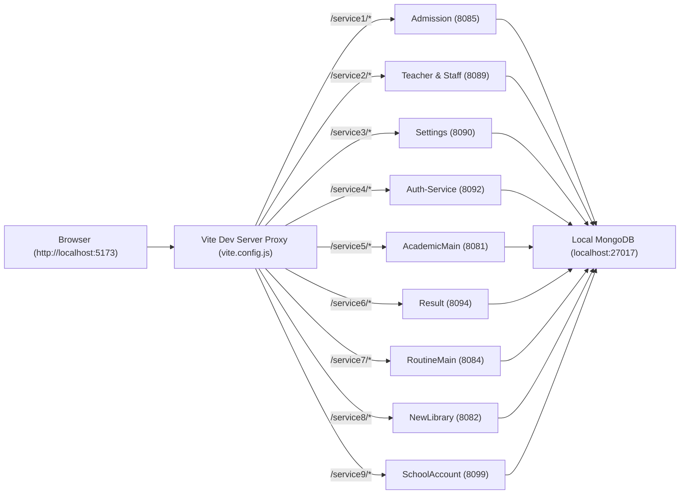

# Local Frontend ↔ Backend Integration & Full Component Audit Plan

## Goal Description

Connect the active React + Vite frontend ([Saas_School_Frontend_New](file:///c:/Users/VAIS-DT4/Desktop/DonotDeleteIt/Saas_School_Frontend_New)) cleanly to the **9 locally running Spring Boot microservices** under [Recovered-SchoolSaaS-20261121-152414](file:///c:/Users/VAIS-DT4/Desktop/DonotDeleteIt/Recovered-SchoolSaaS-20261121-152414), comment out unused/production environment variables in `.env`, and fix every verified frontend ↔ backend communication bug (hardcoded production URLs, wrong routes/HTTP verbs, path collisions, response-shape mismatches, broken `DeleteComponent` props, and a React Rules-of-Hooks crash in `App.jsx`).

### Current System Architecture (Verified Live)

All **9 Spring Boot microservices** and **local Docker MongoDB (`localhost:27017`, 41 schools)** are already up, compiled with local inter-service URLs, and responding locally. However, `Saas_School_Frontend_New` still has production URLs (`https://collage.vaisacademy.com`) in `.env`, no Vite dev proxy in `vite.config.js`, and 15+ frontend component call bugs discovered during our full static + live audit of **236 frontend files (314 HTTP call sites)** against **562 backend REST endpoints**.



**Why Vite Same-Origin Proxy (`/service1`–`/service9`) instead of direct cross-origin `http://localhost:808x` URLs?**
1. `LoginPage.jsx` and `Header.jsx` send `withCredentials: true` to Auth-Service (`8092`), which sets `HttpOnly; Secure; SameSite=None` cookies. Routing through Vite proxy makes every request **same-origin** (`http://localhost:5173/serviceX/...`), completely avoiding CORS preflight and cookie issues.
2. It matches production nginx routing (`/service1`–`/service9`) 1-to-1 and works cleanly even when accessed over LAN (`server.host: true`).

---

## User Review Required

> [!IMPORTANT]
> **External `schoolfeed` Service (73 Frontend Calls Not Present Locally)**
> Our full scan found **73 API calls** targeting a separate Node.js `schoolfeed` service (`https://collage.vaisacademy.com/schoolfeed`) that is **not present in this local workspace** (neither port `5000` nor `8086` is running locally). Affected features:
> - **Billing / Inventory** (`src/components/Billing/*` — 39 calls)
> - **Social Posts & Notification Polling** (`src/components/Posts/*`, `src/utils/posts/*`, `src/utils/notifications/*`, `src/utils/auth/socialFeedAuth.js`, `src/utils/socket.js`, `Header.jsx` 30-second poller — 23 calls)
> - **Result Publish Date** (`SetResultDatePage.jsx`, `MarksheetPage.jsx` student date check — 6 calls)
> - **Additional Subject Marks** (`AditionalSubjectMarkRegisterPage.jsx`, `MarksheetPage.jsx` — 5 calls)
> - **Headmaster Signature Photo** (`InstituteInformationPage.jsx`, `AdmitCardPage.jsx`, `MarksheetPage.jsx` — 6 calls)
>
> **Proposed default:** Comment out `VITE_REACT_BASE_URL_LOCAL`, `VITE_REACT_BASE_URL_DEMO`, and `VITE_REACT_RESULT_DATE_API` in `.env`, remove hardcoded `https://collage.vaisacademy.com/schoolfeed/api` from `src/common/api.js` and `src/common/posts.js`, and **safely guard** all optional `schoolfeed` calls in `App.jsx`, `Header.jsx`, `MarksheetPage.jsx`, `AdmitCardPage.jsx`, and `InstituteInformationPage.jsx` so core local features (Dashboard, Marksheet, Admit Card, School Info) work 100% locally with zero 404/network console errors.

> [!WARNING]
> **Live Razorpay Secret Key in `.env`**
> `Saas_School_Frontend_New/.env` currently defines `VITE_RAZORPAY_KEY_ID` (live key) and `VITE_RAZORPAY_KEY_SECRET` (live secret) which are **unused** across the entire frontend and should never be bundled into client JS. This plan comments both out.

---

## Open Questions

> [!IMPORTANT]
> Please confirm your preference on these 3 points before I begin editing:
> 1. **`schoolfeed` modules (Billing, Social Posts/Notifications, Result Publish Date, Additional Marks, Headmaster Signature):** Should we comment out those `.env` keys and gracefully disable/guard them for a 100% offline/local run (**Recommended**), OR do you have a local Node.js `schoolfeed` server we should proxy to on a specific port (e.g., `5000` or `8086`), OR do you want `schoolfeed` left pointed at production while the 9 Java services run locally?
> 2. **Frontend Dev Port:** Keep Vite on its current port `5173` (**Recommended** — already whitelisted in `auth-service` `CorsConfig.java` and currently running) or switch to `3001`?
> 3. **Auth Forgot-Password Email Link (Backend):** `AuthController.java:185` hardcodes `https://edu.vaisacademy.com/api/auth/reset-password/{token}`. Should we leave all 9 running Java backend services untouched (frontend-only changes — **Recommended** since all 9 backend services already have zero local-communication blockers) or also update `AuthController.java` to make the reset link configurable to `http://localhost:5173` (requires restarting `auth-service` in IntelliJ)?

---

## Proposed Changes

### 1. Environment Configuration & Vite Local Proxy

#### [MODIFY] [.env](file:///c:/Users/VAIS-DT4/Desktop/DonotDeleteIt/Saas_School_Frontend_New/.env)
Comment out all old production, ngrok, LAN IP, unused Razorpay live keys, and non-local `schoolfeed` env vars; configure relative `/service1`–`/service9` paths for Vite's local proxy.

```env
# ==============================================================================
# OLD PRODUCTION / UNUSED ENV VARIABLES (Commented out for local development)
# ==============================================================================
# VITE_RAZORPAY_KEY_ID="rzp_live_Ce8km4QHxZHzBU"
# VITE_RAZORPAY_KEY_SECRET="jk9j6pAC54EgX6Ce5vdZbHiC"

# VITE_REACT_BASE_URL = "https://731da7c71f22.ngrok-free.app"
# VITE_REACT_BASE_URL = "https://collage.vaisacademy.com"

# VITE_REACT_BASE_URL_LOCAL = "http://192.168.0.112:5000"
# VITE_REACT_BASE_URL_LOCAL = "https://collage.vaisacademy.com/schoolfeed"

# VITE_REACT_BASE_URL_DEMO = "http://192.168.0.113:8086"
# VITE_REACT_BASE_URL_DEMO = "https://collage.vaisacademy.com/schoolfeed"

# VITE_REACT_RESULT_DATE_API="http://192.168.0.113:5000/api/resultPublishDate"
# VITE_REACT_RESULT_DATE_API="https://collage.vaisacademy.com/schoolfeed/api/resultPublishDate"

# ==============================================================================
# LOCAL DEVELOPMENT ENV (Routed via vite.config.js proxy -> localhost:8081-8099)
# ==============================================================================
VITE_REACT_razorpay_key = "rzp_test_nRkrV0ODyqs6co"
VITE_REACT_BASE_URL = ""

VITE_REACT_SERVICE1_URL = "/service1"
VITE_REACT_SERVICE2_URL = "/service2"
VITE_REACT_SERVICE3_URL = "/service3"
VITE_REACT_SERVICE4_URL = "/service4"
VITE_REACT_SERVICE5_URL = "/service5"
VITE_REACT_SERVICE6_URL = "/service6"
VITE_REACT_SERVICE7_URL = "/service7"
VITE_REACT_SERVICE8_URL = "/service8"
VITE_REACT_SERVICE9_URL = "/service9"

VITE_REACT_VERSION = "1.2.4"
```

#### [MODIFY] [vite.config.js](file:///c:/Users/VAIS-DT4/Desktop/DonotDeleteIt/Saas_School_Frontend_New/vite.config.js)
Add `server.proxy` mapping all 9 microservice routes to their running local Spring Boot ports with path-prefix stripping:

```js
  server: {
    open: true,
    port: 5173,
    host: true,
    proxy: {
      '/service1': { target: 'http://localhost:8085', changeOrigin: true, rewrite: (p) => p.replace(/^\/service1/, '') },
      '/service2': { target: 'http://localhost:8089', changeOrigin: true, rewrite: (p) => p.replace(/^\/service2/, '') },
      '/service3': { target: 'http://localhost:8090', changeOrigin: true, rewrite: (p) => p.replace(/^\/service3/, '') },
      '/service4': { target: 'http://localhost:8092', changeOrigin: true, rewrite: (p) => p.replace(/^\/service4/, '') },
      '/service5': { target: 'http://localhost:8081', changeOrigin: true, rewrite: (p) => p.replace(/^\/service5/, '') },
      '/service6': { target: 'http://localhost:8094', changeOrigin: true, rewrite: (p) => p.replace(/^\/service6/, '') },
      '/service7': { target: 'http://localhost:8084', changeOrigin: true, rewrite: (p) => p.replace(/^\/service7/, '') },
      '/service8': { target: 'http://localhost:8082', changeOrigin: true, rewrite: (p) => p.replace(/^\/service8/, '') },
      '/service9': { target: 'http://localhost:8099', changeOrigin: true, rewrite: (p) => p.replace(/^\/service9/, '') },
    },
  },
```

#### [MODIFY] [start-frontend.ps1](file:///c:/Users/VAIS-DT4/Desktop/DonotDeleteIt/Recovered-SchoolSaaS-20261121-152414/start-frontend.ps1)
Update target directory from `Saas_School_Frontend_New - Copy` to `Saas_School_Frontend_New` and update console message to `http://localhost:5173`.

---

### 2. Core App Shell, Auth & Global Pre-Fetch Hooks

#### [MODIFY] [App.jsx](file:///c:/Users/VAIS-DT4/Desktop/DonotDeleteIt/Saas_School_Frontend_New/src/App.jsx)
- **Lines 53–66 (Critical React Crash Fix):** Remove the `if (isLogin) { ... }` wrapper around the 12 `useFetch*()` hooks. Calling hooks conditionally violates React's Rules of Hooks and crashes on login/logout transitions (`Rendered more hooks than during the previous render`). Every hook in `AllFetchFunction.jsx` already checks `if (!isLogin || !schoolId) return;` inside its `useEffect`.
- **Line 22:** Remove unused `connectWebSocket, disconnectWebSocket` import pointing to dead `ws://localhost:8080/ws`.
- **Lines 69–82:** Only invoke `initializeSocialFeed(...)` when `import.meta.env.VITE_REACT_BASE_URL_LOCAL` is configured, preventing failing production `schoolfeed` POSTs and `localhost:5000` Socket.IO connection errors.

#### [MODIFY] [AllFetchFunction.jsx](file:///c:/Users/VAIS-DT4/Desktop/DonotDeleteIt/Saas_School_Frontend_New/src/helper/AllFetchFunction.jsx)
- **Line 85 (`useFetchAllSubject`):** Change `${academicUrlApi.getAllSubject.url}/${schoolId}` → `${academicUrlApi.getAllSubject.url}/all/${schoolId}` so universal + school-specific subjects both load (matching `classes/all` and `sections/all` and avoiding `404` for schools with only universal subjects).
- **Line 232 (`useFetchAllClassTime`):** Fix `404` route collision! Change `${routineUrlApi.getClassTime.url}/${schoolId}` (hits `GET /api/v1/routine/class-time/{id}`) → `${routineUrlApi.getClassTime.url}/all/${schoolId}` (verified `200 OK` on live Service 7).

#### [MODIFY] [Header.jsx](file:///c:/Users/VAIS-DT4/Desktop/DonotDeleteIt/Saas_School_Frontend_New/src/components/Header/Header.jsx)
- **Lines 149–154 (Logout):** Fix `axios.post(url, data, config)` argument order — pass `{}` as request body and `{ headers: { "Content-Type": "application/json" }, withCredentials: true }` as the 3rd config argument so `withCredentials` is actually applied.
- **Lines 97–104 (Notification Polling):** Guard `fetchUserNotifications()` and the 30s `setInterval` with `if (!import.meta.env.VITE_REACT_BASE_URL_LOCAL) return;` when `schoolfeed` is not configured locally.

---

### 3. Centralized API Config Modules (`src/common/` & `src/utils/`)

#### [MODIFY] [result.js](file:///c:/Users/VAIS-DT4/Desktop/DonotDeleteIt/Saas_School_Frontend_New/src/common/result.js)
- Add centralized `criteria` (`${resultApi}/schools/criteria`) and `marksheet` (`${resultApi}/marksheet`) endpoints for Service 6 (`Result`).
- Fix `searchResultApi` from `${baseUrl1}/attendance` to `${baseUrl1}` (eliminating double `/attendance` risk).
- Guard `resultDateBaseUrl`: when `VITE_REACT_RESULT_DATE_API` is unset, expose empty strings instead of `"undefined/search"`.

#### [MODIFY] [main.js](file:///c:/Users/VAIS-DT4/Desktop/DonotDeleteIt/Saas_School_Frontend_New/src/common/main.js)
- Guard `headmasterSignaturePhoto.url`: set to `baseUrl2 ? `${baseUrl2}/api/headmasterSignaturePhoto` : ""` so components don't request `undefined/api/headmasterSignaturePhoto/{schoolId}`.

#### [MODIFY] [api.js](file:///c:/Users/VAIS-DT4/Desktop/DonotDeleteIt/Saas_School_Frontend_New/src/common/api.js), [posts.js](file:///c:/Users/VAIS-DT4/Desktop/DonotDeleteIt/Saas_School_Frontend_New/src/common/posts.js), [socket.js](file:///c:/Users/VAIS-DT4/Desktop/DonotDeleteIt/Saas_School_Frontend_New/src/utils/socket.js)
- Replace hardcoded `'https://collage.vaisacademy.com/schoolfeed/api'` and `'http://localhost:5000'` with `import.meta.env.VITE_REACT_BASE_URL_LOCAL` (guarded when unset so zero traffic leaks to production or dead port `5000`).

---

### 4. Verified Component-Level API, Route, Verb & Prop Fixes

Every single issue below was verified directly against the live Spring Boot controllers:

| # | File | Current Broken Code | Verified Fix | Target Service |
| :--- | :--- | :--- | :--- | :--- |
| **1** | [MarkRegisterPage.jsx](file:///c:/Users/VAIS-DT4/Desktop/DonotDeleteIt/Saas_School_Frontend_New/src/pages/Result/MarkRegisterPage.jsx#L216-L218) & [#L369-L371](file:///c:/Users/VAIS-DT4/Desktop/DonotDeleteIt/Saas_School_Frontend_New/src/pages/Result/MarkRegisterPage.jsx#L369-L371) | Hardcoded `https://collage.vaisacademy.com/service6/api/schools/criteria/search/...` and `.../api/marks-register/...` | Use `${resultUrlApi.criteria.url}/search/${schoolId}...` and `${resultUrlApi.markRegister.url}/${schoolId}` | Service 6 (`8094`) |
| **2** | [SetMarksForExamTypePage.jsx](file:///c:/Users/VAIS-DT4/Desktop/DonotDeleteIt/Saas_School_Frontend_New/src/pages/Result/SetMarksForExamTypePage.jsx#L91-L182) & [#L1028-L1035](file:///c:/Users/VAIS-DT4/Desktop/DonotDeleteIt/Saas_School_Frontend_New/src/pages/Result/SetMarksForExamTypePage.jsx#L1028-L1035) | 4 hardcoded `https://collage.vaisacademy.com/service6/api/schools/criteria/...` calls + `<DeleteComponent onSuccess={...} />` (crashes with `onDelete is not a function`) | Use `${resultUrlApi.criteria.url}/...` for all 4 CRUD calls + change `onSuccess` → `onDelete` | Service 6 (`8094`) |
| **3** | [MarksheetPage.jsx](file:///c:/Users/VAIS-DT4/Desktop/DonotDeleteIt/Saas_School_Frontend_New/src/pages/Result/MarksheetPage.jsx#L245-L306) | Hardcoded `https://collage.vaisacademy.com/service6/api/marksheet/...` + unguarded `await axios.get(additionalApiUrl)` crashes entire marksheet when `schoolfeed` is absent | Use `${resultUrlApi.marksheet.url}/...` + wrap optional `additionalApiUrl`, `resultDate`, and `headmasterSignaturePhoto` calls with env checks & isolated `try/catch` | Service 6 (`8094`) |
| **4** | [ClassRoutinesPage.jsx](file:///c:/Users/VAIS-DT4/Desktop/DonotDeleteIt/Saas_School_Frontend_New/src/pages/Routines/ClassRoutinesPage.jsx#L58-L62) | `GET ${routineUrlApi.getRoutine.url}/${schoolId}` (`404`, collides with `/{id}`) + `response.data.data` (`undefined`, endpoint returns raw array `[]`) | Change URL to `${routineUrlApi.getRoutine.url}/all/${schoolId}` and dispatch `response?.data?.data ?? response?.data ?? []` | Service 7 (`8084`) |
| **5** | [ViewAllTcApplicationPage.jsx](file:///c:/Users/VAIS-DT4/Desktop/DonotDeleteIt/Saas_School_Frontend_New/src/pages/TC/ViewAllTcApplicationPage.jsx#L212-L379) | 4 calls use `mainUrlApi?.tcRequest?.url` (`/transfer-certificates/request/...`), causing Approve/Reject/Download to hit wrong controller mappings or `404` | Change all 4 (`approve`, `reject`, `download/{id}/{schoolId}`, `download?tcNumber=`) to use `mainUrlApi?.tcDetails?.url` (`/transfer-certificates/...`) | Service 1 (`8085`) |
| **6** | [StudentInformationPage.jsx](file:///c:/Users/VAIS-DT4/Desktop/DonotDeleteIt/Saas_School_Frontend_New/src/pages/studentInfo/StudentInformationPage.jsx#L1184-L1187) | `deletePath="${mainUrlApi.studentInfo.url}/${item.id}/${schoolId}"` (`405 Method Not Allowed`) | Change to `${mainUrlApi.studentInfo.url}/number/${item.admissionNumber}/${schoolId}` (matches `AdmissionController.deleteAdmissionByNumberAndSchool`) | Service 1 (`8085`) |
| **7** | [PromoteStudentPage.jsx](file:///c:/Users/VAIS-DT4/Desktop/DonotDeleteIt/Saas_School_Frontend_New/src/pages/studentInfo/PromoteStudentPage.jsx#L224) | Trailing space in URL: `` `${mainUrlApi?.admissioin?.url}/promote-bulk/${schoolId} ` `` sends `%20` in `schoolId` | Remove trailing space: `` `${mainUrlApi?.admissioin?.url}/promote-bulk/${schoolId}` `` | Service 1 (`8085`) |
| **8** | [AddStudentFeesPage.jsx](file:///c:/Users/VAIS-DT4/Desktop/DonotDeleteIt/Saas_School_Frontend_New/src/pages/Fees/AddStudentFeesPage.jsx#L1551-L1556) | `<DeleteComponent url="${accountApi}/api/fees-structure/${item.id}/${schoolId}" refetch={fetchStudentFeesData} />` (3 bugs: wrong prop `url`, wrong prop `refetch`, wrong route missing `/delete/`) | Fix to `name={item.className}`, `deletePath={`${accountApi}/api/fees-structure/delete/${item.id}/${schoolId}`}`, `onDelete={fetchStudentFeesData}` | Service 9 (`8099`) |
| **9** | [DeleteComponent.jsx](file:///c:/Users/VAIS-DT4/Desktop/DonotDeleteIt/Saas_School_Frontend_New/src/components/DeleteData/DeleteComponent.jsx#L36) | Calls `onDelete()` unconditionally (throws `TypeError` if prop missing) | Guard with `onDelete?.();` | Shared Component |
| **10** | [SubjectPage.jsx](file:///c:/Users/VAIS-DT4/Desktop/DonotDeleteIt/Saas_School_Frontend_New/src/pages/academic/SubjectPage.jsx#L70-L72) & [AssignmentPage.jsx](file:///c:/Users/VAIS-DT4/Desktop/DonotDeleteIt/Saas_School_Frontend_New/src/pages/Assignment/AssignmentPage.jsx#L45-L47) | `GET ${academicUrlApi.getAllSubject.url}/${schoolId}` (returns `404` if school uses only universal subjects) | Change to `${academicUrlApi.getAllSubject.url}/all/${schoolId}` | Service 5 (`8081`) |
| **11** | [SignUpStep2Page.jsx](file:///c:/Users/VAIS-DT4/Desktop/DonotDeleteIt/Saas_School_Frontend_New/src/pages/Auth/SignUpStep2Page.jsx#L405-L412) | Hardcoded `http://localhost:5000/create-order` and `"YOUR_RAZORPAY_KEY_ID"` | Use `${mainUrlApi.signUp.url}/create-order` and `import.meta.env.VITE_REACT_razorpay_key` | Service 1 (`8085`) |
| **12** | [AdmitCardPage.jsx](file:///c:/Users/VAIS-DT4/Desktop/DonotDeleteIt/Saas_School_Frontend_New/src/pages/Card/AdmitCardPage.jsx#L91-L110) & [InstituteInformationPage.jsx](file:///c:/Users/VAIS-DT4/Desktop/DonotDeleteIt/Saas_School_Frontend_New/src/pages/Setting/InstituteInformationPage.jsx) | Unconditionally calls `mainUrlApi.headmasterSignaturePhoto.url` even when `schoolfeed` env is commented out | Early-return `if (!mainUrlApi.headmasterSignaturePhoto.url || !schoolId) return;` | Optional `schoolfeed` guard |
| **13** | [InvoiceesComponent.jsx](file:///c:/Users/VAIS-DT4/Desktop/DonotDeleteIt/Saas_School_Frontend_New/src/components/Billing/InvoiceesComponent.jsx#L39) | Double slash `${BASE_URL}/api/sales//get-all-invoice/${schoolId}` | Fix to `${BASE_URL}/api/sales/get-all-invoice/${schoolId}` | Billing cleanup |

---

### 5. Verified Clean & Documented Non-Microservice Placeholders

- **207 remaining frontend API calls** across Academic (`ClassPage`, `SectionPage`, `ClassRoomPage`, `SubjectAssignPage`), Accounts (`IncomePage`, `ExpensePage`, `BankTransactionPage`, `ReportsPage`, `StudentFeeCollectionPage`, `TuitionFeesCollectionPage`), Admission, Attendance (`MarkAttendancePage`, `AttendanceReportPage`, `AttendanceBarComponent`), Auth (`LoginPage`, `SignupPage`, `ForgotPasswordPage`, `CreateNewPasswordPage`), Cards (`IdCardPage`, `AdmitCardPage`), Dashboards (`DashboardPage`, `TeacherDashboardPage`, `StudentDashboardPage`, `EdpDashboardPage`, `LibrarianDashboardPage`), Staff (`Teacher`, `EDP`, `Librarian`, `Accountant`), Fees (`ClassFeesPage`, `StudentServiceFeesPaymentPage`), Library (all 5 pages), Payment (`PaymentHistoryPage`, `PreviousDuePage`), Promotion (`PromotionHistoryPage`), Result (`GradeSystemPage`, `ViewMarksPage`), Routines (`ClassTimePage`, `ExamTypePage`, `ExamRoutinesPage`, `AddNewClassRoutines`, `UpdateClassRoutineComponent`, `UpdateExamRoutine`), Settings (`BloodGroupPage`, `GendersPage`, `ReligionsPage`, `ServicePage`), Events (`AddEventPage`, `RecentEventsComponent`), Assignments (`AssignmentPage`, `StudentAssignmentPage`), and TC (`ApplyForTCPage`) **already match their exact Spring Boot controller paths and HTTP methods** and will automatically route locally once `.env` and `vite.config.js` are updated.
- **Known Unimplemented Placeholders (No Backend Controller Exists):** `AttendancePage.jsx`, `AbsentFeesPage.jsx`, `LibraryLateFeesPage.jsx` (all call literal `"url"`), and `ChatWithSupport.jsx` (external chatbot `http://147.93.116.69:5000/chat`, already commented out in `App.jsx`). These will be left untouched and noted in the walkthrough.

---

## Verification Plan

### Automated Verification
1. **Frontend Production Build Check:**
   Run `npm run build` in `c:\Users\VAIS-DT4\Desktop\DonotDeleteIt\Saas_School_Frontend_New` to confirm zero syntax, JSX, or import/bundling errors.
2. **Vite Dev Proxy End-to-End API Verification:**
   Restart Vite (`http://localhost:5173`) so it picks up the updated `.env` and `vite.config.js` proxy rules, then run a read-only verification script calling **every microservice (`/service1` through `/service9`) through `http://localhost:5173/serviceX/...`** — specifically verifying all newly fixed endpoints (`/service7/api/v1/routine/class-time/all/{schoolId}`, `/service7/api/v1/routine/all/{schoolId}`, `/service5/api/v1/Academic/subjects/all/{schoolId}`, `/service6/api/schools/criteria/{schoolId}`, `/service1/transfer-certificates/requests/{schoolId}`, `/service4/api/auth/login`, etc.) return `200 OK` with expected JSON payloads.
3. **Static Regression Audit:**
   Re-run our cross-check script to confirm **0 hardcoded `collage.vaisacademy.com` microservice URLs**, **0 `localhost:5000` microservice calls**, **0 route/verb mismatches**, and **0 conditional hook violations**.

### Live Browser & Manual Verification
1. Open `http://localhost:5173/login` in the browser and sign in with a local account from `auth_sas` MongoDB.
2. Confirm:
   - Login succeeds via `POST /service4/api/auth/login` (`200 OK`) and transitions to the dashboard **without** any React Hook error.
   - All 12 global pre-fetch calls in the Network tab hit `http://localhost:5173/serviceX/...` (local backends) with **zero requests to `collage.vaisacademy.com`** and **zero `404`/`500`/CORS errors**.
   - Navigate through key modules (Classes, Sections, Subjects, Class Times, Class Routines, Exam Routines, Mark Register, Set Marks Criteria, Marksheet, Student Info, TC Applications, Accounts/Expenses/Bank, Fees Structure, Library, Settings) and verify data renders cleanly from local MongoDB.
